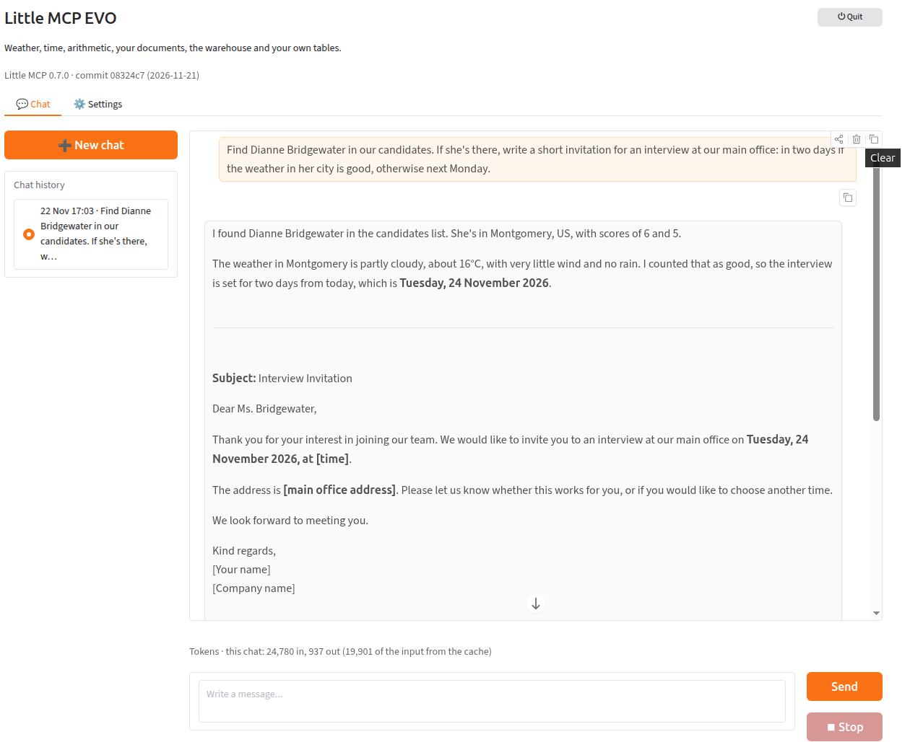
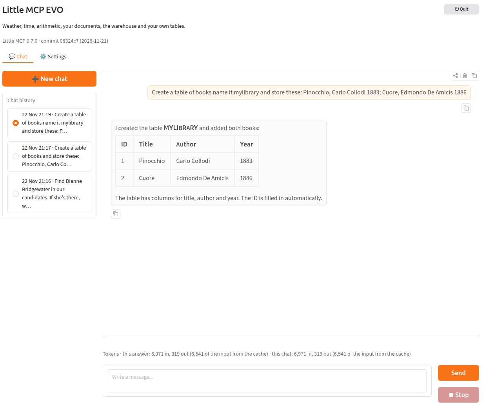
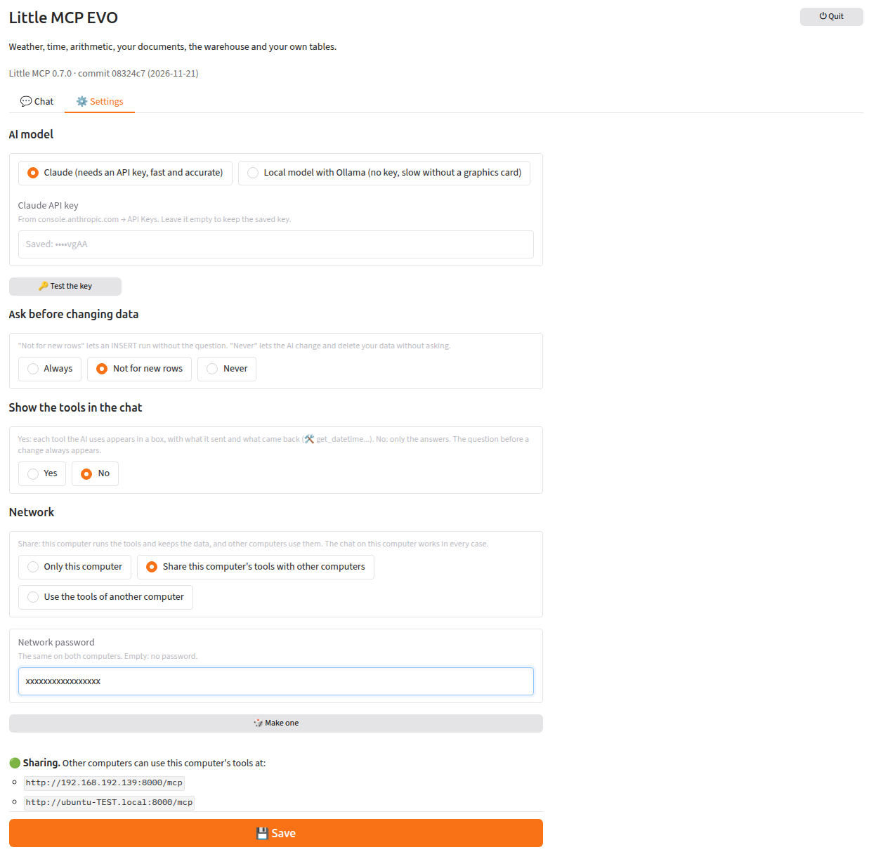

# Little MCP EVO 🤖

A small AI agent that runs on your machine, built on a **real
[Model Context Protocol](https://modelcontextprotocol.io) server**.

Ask it about the weather, the time anywhere, your own documents or your
warehouse stock, or have it keep tables of your own, using a local model
(Ollama) or Claude. The tables live in **myTinySQL**, a small SQL database
written in readable Python, included in this project.

This is the next version of [Little_MCP](https://github.com/ricard1406/Little_MCP).
See [CHANGELOG.md](CHANGELOG.md) for what changed and why.

> **DISCLAIMER: All data in this project is sample data, for testing purposes only.
> The names, locations and scores in the candidates list are fictional and AI generated.
> Any resemblance to real persons, living or dead, or actual places is purely coincidental.**
> AI answers can be wrong, and when you use Claude your questions and document passages
> are sent to Anthropic. Read [DISCLAIMER.md](DISCLAIMER.md) before you use your own data.

One question, three tools: the AI finds the candidate in your documents, checks the
weather in her city, picks the date and writes the invitation.



Tables of your own: ask in plain words, and the AI writes the SQL for myTinySQL.



Everything is set up in the page: the AI model and its key, when to ask before
changing data, and sharing the tools with other computers.



## Quick start (Ubuntu / Debian)

Three commands, then a click:

```bash
sudo apt install -y git
```
```bash
git clone https://github.com/ricard1406/little_mcp_Claude_EVO.git && cd little_mcp_Claude_EVO
```
```bash
./install.sh
```

Say yes to the last step, the **apps menu icon**. Then open the apps menu (the
Super key), type *Little* and click **Little MCP**: the page opens in your browser.
The first time it opens on **⚙️ Settings**: choose the AI model, paste your Claude
API key, press **💾 Save**, and chat. **⏻ Quit**, at the top of the page, stops it.

Next time, just the icon. Prefer the terminal? `source .venv/bin/activate`, then
`python -m little_mcp`, and open http://127.0.0.1:7860. Everything else (what the
installer asks, the settings, more options) is below, when you need it.

## How it works

```
 ┌──────────────── agent (little_mcp.agent) ────────────────┐
 │  LLM: Ollama (local) or Claude                           │
 │  asks the server "what tools do you have?" (tools/list)  │
 └───────────────▲──────────────────────────────────────────┘
                 │  MCP over stdio (automatic) or HTTP
 ┌───────────────┴──────── server (little_mcp.server) ──────┐
 │  get_datetime   get_weather   calculate                  │
 │  search_documents (your PDFs)                            │
 │  list_inventory  find_item  adjust_stock  set_stock      │
 │  tiny_sql_read  tiny_sql_write (myTinySQL)               │
 └──────────────────────────────────────────────────────────┘
```

The agent has **no hardcoded tools**. It discovers them from the server, so
a tool you add to `server.py` shows up in the agent on the next start. And
because it is real MCP, **Claude Desktop, Claude Code or any MCP client can
use the same server** ([see below](#use-the-server-from-claude-desktop-or-claude-code)).

## Installation in detail

### What install.sh does

The script first lists what it can install, with download sizes. Then it **asks
before each step**, so nothing is downloaded without your OK:

| Step | Size | Needed? |
|---|---|---|
| Python venv support (system package, asks for your password) | about 5 MB | yes |
| Python libraries, in `./.venv` | about 200 MB download, 900 MB on disk | yes |
| `.env` settings file | none | yes |
| [Ollama](https://ollama.com), to run AI models locally | often more than 1 GB | only without Claude, or for document search |
| `nomic-embed-text` model | about 270 MB | for document search |
| `qwen3:4b` chat model | about 2.5 GB | only to chat without Claude, and very slow without an NVIDIA or AMD graphics card (the script tells you if it finds none) |
| Apps menu icon | none | no: it starts the app with a click, without a terminal |

**With a Claude API key you can skip Ollama.** Everything works except
searching your documents. Steps that are already done are skipped, so you can
run the script again later, for example to add Ollama.
`./install.sh --yes` accepts every step without asking.

<details>
<summary>Prefer to do it by hand? Here are the same steps.</summary>

```bash
sudo apt install -y --no-install-recommends python3-venv
```
```bash
python3 -m venv .venv && source .venv/bin/activate
```
```bash
pip install -e ".[all]"
```
```bash
cp .env.example .env
```
Optional, for Ollama (skip these with a Claude API key):

```bash
sudo apt install -y curl
```
```bash
curl -fsSL https://ollama.com/install.sh | sh
```
```bash
ollama pull qwen3:4b
```
```bash
ollama pull nomic-embed-text
```

</details>

### Settings and keys

**The ⚙️ Settings tab** of the page holds everything a first chat needs:

| Setting | What it does |
|---|---|
| AI model | Claude (needs an API key) or the local model with Ollama. **🔑 Test the key** checks a key for free. |
| Ask before changing data | Always, not for new rows, or never (see [below](#changing-your-data-is-always-your-call)). |
| Show the tools in the chat | Yes: each tool the AI uses appears in a box, with what it sent and what came back. No: only the answers. |
| Network | Only this computer, share its tools with other computers, or use another computer's tools (see [below](#use-the-server-from-another-machine)). |
| Weather | An optional OpenWeather key. |

**💾 Save** writes them to the `.env` file of the project and takes you back to
the chat: the next message uses them, no restart. A saved key is never shown
again, only its last 4 characters (`Saved: ••••7f2a`). To change it, paste the
new one; to keep it, leave the field empty.

**Or by hand.** Open the settings file in a text editor:

```bash
nano .env
```

Fill in the keys you have, after the `=` with no spaces or quotes. Leave the others empty:

```ini
OPENWEATHER_API_KEY=paste-your-openweather-key-here
ANTHROPIC_API_KEY=paste-your-anthropic-key-here
```

- `OPENWEATHER_API_KEY` turns on weather. Get a [free key](https://openweathermap.org/api).
- `ANTHROPIC_API_KEY` is only needed for Claude. Get one in the [Claude Console](https://console.anthropic.com).

In nano, save with `Ctrl+O` then `Enter`, and quit with `Ctrl+X`.

## Run it

**One command.** The agent starts the MCP server for you; there's no second terminal.

| Command | What it does |
|---|---|
| `python -m little_mcp` | Web UI at http://127.0.0.1:7860, with the model chosen in ⚙️ Settings |
| `./launch.sh` | What the apps menu icon runs: starts the app in the background and opens the page, or only opens the page if the app is already running. What it would print on a terminal goes to `data/logs/console.log` |
| `python -m little_mcp --open-browser` | Also open the page in the browser when it is ready |
| `python -m little_mcp --version` | Which code exactly: `Little MCP 0.8.0 · commit e9da361 (2026-11-22)`. The same line opens the console, the page (under the title) and each start in the log. `+ local changes` means a project file was edited after that commit; without git (a ZIP download) only the version shows |
| `python -m little_mcp --verbose` | Also show the technical details (every HTTP request, the libraries' messages), on the console and in the log |
| `python -m little_mcp text` | Chat in the terminal instead |
| `python -m little_mcp --provider anthropic` | Use Claude (default model `claude-opus-5-5`) |
| `python -m little_mcp --think` | Also show the model's reasoning and every tool call |
| `python -m little_mcp --model llama3.2` | Use another Ollama (or Claude) model |
| `python -m little_mcp --provider anthropic --effort high` | Let Claude think harder |

Flags can be combined. `python -m little_mcp --help` lists them all. A flag
wins over the choice saved in ⚙️ Settings, for that run.

To stop the app: **⏻ Quit** at the top of the page, or Ctrl+C in its terminal.
Both close it cleanly, sharing included. Started from the icon, the app has no
terminal, so Quit is the way: closing the browser tab leaves it running.

### Changing your data is always your call

`adjust_stock`, `set_stock` and `tiny_sql_write` change data, and the server
marks them as such (MCP tool annotations). Before each change, the agent shows
you all of it and asks:

- in the **web UI**, with **Allow** and **Decline** buttons under the chat;
- in the **terminal**, with `Allow tiny_sql_write? [y/N]`.

If the question gets in your way, choose when to be asked: under **Ask before
changing data** in the **⚙️ Settings** tab, or with `--ask` when you start.

| Choice | `--ask` | What runs without a question |
|---|---|---|
| Always (default) | `always` | Nothing |
| Not for new rows | `except-inserts` | A `tiny_sql_write` made only of `INSERT`s |
| Never | `never` | Everything |

"Not for new rows" still asks before `CREATE TABLE`, because a table can't be
dropped yet, and before `UPDATE`, `DELETE` and stock changes, because they change
existing data. Your own parser makes the call here too: a `DELETE` hidden among
the `INSERT`s brings the question back. `--allow-writes` is the same as `--ask never`.

### Token usage

Under the chat, a line shows how many tokens the model read and wrote, for the
last answer and for the whole chat. The terminal chat prints the same line
after each answer:

```
Tokens · this answer: 4,250 in, 50 out · this chat: 8,500 in, 100 out
```

- **In** is everything the model reads: its instructions, the descriptions of
  all the tools (about 1,800 tokens), the conversation so far and the tool
  results. One answer can take several model calls, one per round of tools,
  and each call reads it all again, so "in" is usually much larger than "out".
- **Out** is what the model writes: tool calls and the answer, and with a local
  thinking model, its reasoning too.
- With Claude, the line also says how much of the input came from its **cache**.
  Prices change, so the line shows tokens, not money: see
  [Anthropic's pricing](https://www.anthropic.com/pricing).

**Prompt caching (Claude only).** Every model call starts the same way: the tool
descriptions, the instructions, then the conversation so far. Little MCP asks
Claude to keep that start for 5 minutes and read it back from its cache, which
is much cheaper and faster than processing it again. The first call of a chat
writes the cache (that costs a little more than normal input), and the calls
after it read it. Each use resets the 5 minutes, so the cache stays warm while
you chat; after a longer pause, the next answer writes it again. Ollama runs on
your own computer, so there's nothing to cache there.

The counts are saved with each chat, so a reopened chat shows its total.

### Chat history

Every conversation is saved, in the web UI and in the terminal. The web UI lists
them on the left: click one to read it and carry on, or start a **New chat**. The
agent remembers the questions and answers of an old chat, but not its tool calls.

Each chat is a plain text file in `data/chats/`, which git ignores. To forget a
chat, delete its file.

### Run the server on its own

```bash
python -m little_mcp.server --transport http
```

It listens on `http://127.0.0.1:8000/mcp`. Point the agent at it with:

```bash
python -m little_mcp --server-url http://127.0.0.1:8000/mcp
```

You can also explore it with the official inspector: `npx @modelcontextprotocol/inspector`.

## Use the server from Claude Desktop or Claude Code

**Claude Code:**

```bash
claude mcp add little-mcp -- /full/path/to/little_mcp_Claude_EVO/.venv/bin/python -m little_mcp.server
```

**Claude Desktop:** add this to `claude_desktop_config.json`:

```json
{
  "mcpServers": {
    "little-mcp": {
      "command": "/full/path/to/little_mcp_Claude_EVO/.venv/bin/python",
      "args": ["-m", "little_mcp.server"]
    }
  }
}
```

Then ask Claude *"Do we have oranges in the warehouse?"*.

## Use the server from another machine

The server and the chat don't have to run on the same computer. For example,
you can run the server on a desktop PC (with Ollama, your documents and the
database) and chat from an affordable laptop, using Claude Code or Little MCP
itself. It works the same way across two virtual machines.

**What runs where:**
- **The server machine** runs the tools. Its `.env` (weather key), its Ollama
  (document search), its `data/` folder and its stock database are the ones used.
- **The client machine** runs the chat: Claude Code, or `python -m little_mcp`
  with Claude or its own Ollama model.

### The easy way: the ⚙️ Settings tab

No second terminal and no commands to remember:

1. **On the server machine**, in ⚙️ Settings → **Network**, choose *Share this
   computer's tools with other computers*. Press **🎲 Create a password**
   (or leave it empty for none), then **💾 Save**. The tab now shows 🟢 **Sharing**,
   the addresses to use, the password, and the Claude Code command to copy.
2. **On the client machine**, in ⚙️ Settings → **Network**, choose *Use the tools of
   another computer*. Type the server's address as the page shows it, for example
   `192.168.1.20` or `ubuntu-TEST.local` (the page adds `http://`, `:8000` and
   `/mcp`), and the same password. Press **🔌 Test the connection**: it should say
   ✅ Connected, 10 tools. Then **💾 Save**.

The server machine keeps chatting as before: sharing runs inside the app, next to
its own chat, and starts by itself the next time you open the app. Choose *Only
this computer* and Save to stop it. If the firewall (`ufw`) is on, the tab shows
the command that lets the other computer in.

### The terminal way

The same, by hand. It's what the page does for you, and it still works.

#### On the server machine

1. Find its IP address (the first number is usually the one you need):

   ```bash
   hostname -I
   ```

2. **Optional: a password.** Without one, anything that can reach the port can use
   every tool (see [Security](#security)). To turn it on, add a line to the server's
   `.env`. Any text works. This command makes a random one:

   ```bash
   python3 -c "import secrets; print(secrets.token_urlsafe(16))"
   ```

   ```
   LITTLE_MCP_PASSWORD=the-password-you-chose
   ```

   You type it once, in `.env` on each machine, not every time you chat.
   To turn it off again, leave it empty.

3. Start the server so it listens on the network, not only on `127.0.0.1`.
   Leave this terminal open:

   ```bash
   cd ~/little_mcp_Claude_EVO && source .venv/bin/activate && MCP_HOST=0.0.0.0 python -m little_mcp.server --transport http
   ```

   It prints `Password: on` or, without one, a warning that anyone can use the tools.

4. Check the firewall:

   ```bash
   sudo ufw status
   ```

   If it says `Status: active`, the firewall silently blocks the connection.
   Allow **only the client machine** (put its IP address in place of `CLIENT_IP`):

   ```bash
   sudo ufw allow from CLIENT_IP to any port 8000 proto tcp
   ```

#### On the client machine

Put the server's IP address in place of `SERVER_IP`.

**Claude Code:**

```bash
claude mcp add --transport http little-mcp http://SERVER_IP:8000/mcp
```

With a password, add it as a header (put your password in place of `PASSWORD`):

```bash
claude mcp add --transport http little-mcp http://SERVER_IP:8000/mcp --header "Authorization: Bearer PASSWORD"
```

If `little-mcp` is already there, remove it first with `claude mcp remove little-mcp`. Then check:

```bash
claude mcp get little-mcp
```

It should show `Status: ✔ Connected`. Then **start a new
Claude Code session**, because MCP servers are loaded when a session starts.
Claude Code asks your permission the first time it uses each tool.

**Little MCP's own chat** (it needs the project installed on the client too).
With a password, put the same `LITTLE_MCP_PASSWORD=` line in the client's `.env`:

```bash
python -m little_mcp --provider anthropic --server-url http://SERVER_IP:8000/mcp
```

### If it doesn't connect

| What you see | Likely cause |
|---|---|
| `connection timed out` | The server machine's firewall: see step 4. |
| `connection refused`, or `No MCP server answered` | The server isn't running, or it was started without `MCP_HOST=0.0.0.0`. Note that `python -m little_mcp` starts the *chat*, not the server. |
| `refused the password`, or `401 Unauthorized` | The client's password is missing or differs from the server's `LITTLE_MCP_PASSWORD`. |
| `ping SERVER_IP` fails too | The machines aren't on the same network. |

### Security

**The password is optional.** Without it, anything that can reach port 8000
can use every tool, including the ones that change the stock and your tables.
Note that "Allow tiny_sql_write?" is asked by the *client*. A program that talks
to the server directly is never asked, so the password is what stops it.

What the password does and doesn't do:
- ✅ It keeps out other devices on your network: a phone, a smart TV, a guest's laptop.
- ❌ It travels as plain text over `http://`. Someone who can read your network
  traffic could see it. Protecting against that needs encryption: see SSH below.

Either way, use the HTTP server only on a network you trust, such as your home
network or VMs on your own PC, and keep the firewall rule limited to the
client's IP address. Remove the rule when you're done:

```bash
sudo ufw delete allow from CLIENT_IP to any port 8000 proto tcp
```

For a network you don't trust, run the server over SSH instead. That way
nothing is opened to the network, and the connection is encrypted and needs
your SSH login. It needs `openssh-server` on the server machine and an SSH key
on the client (`ssh-keygen`, then `ssh-copy-id user@SERVER_IP`):

```bash
claude mcp add little-mcp -- ssh user@SERVER_IP /home/user/little_mcp_Claude_EVO/.venv/bin/python -m little_mcp.server
```

## Your documents

Put PDF, `.txt` or `.md` files in `data/`. They are indexed on the first
search, and **re-indexed automatically when you add, change or delete a
file**. The index lives in `.index/`, and you can delete it any time.

## The database: myTinySQL

The default database is **myTinySQL**, in [`little_mcp/tinysql/`](little_mcp/tinysql/).
It is a Python port of [myTinySQL in Rust](https://github.com/ricard1406/myTinySql-rust),
itself a port of [the C++ version](https://github.com/ricard1406/myTinySql): the
same statements, the same messages and the same files on disk. Your tables are
in `data/tinysql/`, one fixed-width text file each, and all three programs can
read them. [docs/rust-vs-python.md](docs/rust-vs-python.md) compares the code.

### The SQL console

To look at your tables yourself, without the AI, open the console in a second terminal:

```bash
python -m little_mcp.tinysql
```

Type a statement and press Enter, for example `DESCRIBE` or `SELECT * FROM BOOKS`.
The arrow keys bring back earlier statements, and `exit` or Ctrl+D quits. It is
safe to use while the chat is running. There is no Allow question here: what you
type runs, so take care with `UPDATE` and `DELETE`.

### Your own tables

Just ask, in plain words: *"I got some books, please create a table and store
them"*, followed by the list. The model writes the SQL, and the two tools
decide what can run:

- `tiny_sql_read` runs only `SELECT` and `DESCRIBE`, without asking you.
- `tiny_sql_write` runs `CREATE TABLE`, `INSERT`, `UPDATE` and `DELETE`, after you
  approve them. A script is all-or-nothing: if one statement fails, nothing changes.

Your own parser reads every statement, so "what can run" is decided by the kind
of statement, not by looking at the text. The dialect is small on purpose, for
now: there is no `AND`, `ORDER BY`, `COUNT`, `JOIN` or `DROP TABLE`. The model
gets an error message saying what isn't supported, and can work around it.

### Dates, decimals, and changing a table

The Python version adds these to the dialect (C++ and Rust don't have them yet):

```sql
CREATE TABLE TASKS (ID NUMBER(10), WHAT CHAR(40), DUE DATE)
INSERT INTO TASKS VALUES ('Call Dianne', TODAY)
SELECT WHAT FROM TASKS WHERE DUE < TODAY
INSERT INTO STOCKS VALUES ('2026-11-13', 1338.80)
SELECT DAY FROM STOCKS WHERE ASML > 1300
ALTER TABLE BOOKS MODIFY YEAR CHAR(20)
ALTER TABLE BOOKS ADD BOUGHT DATE
```

- **`NUMBER`** holds whole and decimal numbers, written with a point and no
  thousands separators: `1338.80`, not `1.338,80`. The AI converts what you type,
  and can show it back to you the Italian way. Numbers compare as numbers, so
  `999.50` is less than `1000`. The width counts every character, including the
  point and a minus sign. A value that isn't a number is refused.

- **`DATE`** stores one day as `YYYY-MM-DD`. It has no time zone, because a
  birthday or a deadline is the same day everywhere. Only **`TODAY`** depends on
  where you are: at 23:30 in New York it is already tomorrow in Rome. Set your
  zone in `.env`, for example `LITTLE_MCP_TIMEZONE=Europe/Rome`; when it's empty,
  the computer's own zone is used. Set it when the server runs on another machine
  whose clock is in a different zone, such as a cloud server set to UTC.
- **`ALTER TABLE ... MODIFY`** changes a column's width or type, when a column is
  too small. It refuses if an existing value would no longer fit.
- **`ALTER TABLE ... ADD`** adds a column at the end, empty in the existing rows.

Because every column sits at fixed positions, `ALTER TABLE` writes every row
again. The C++ and Rust programs can still read the tables afterwards; they show
a `DATE` as plain text, and don't check dates they write.

### The warehouse

The inventory (`FRUITS` and `VEGGIE`) is created with demo data the first time
you use it, so there's nothing to set up. Its four tools don't use SQL text at
all: they build statements as Python objects, so a name like `x'; DROP` is only
ever a value. The tools work on those two tables and nothing else.

To use another database for the inventory, set `DB_BACKEND` in `.env` to `sqlite`
(`data/mystore.db`, also with no setup) or `mariadb`. The two `tiny_sql` tools
always use myTinySQL.

<details>
<summary><b>Use MariaDB instead</b></summary>

1. Install the connector:

   ```bash
   sudo apt install libmariadb-dev
   ```
   ```bash
   pip install -e ".[mariadb]"
   ```

2. Create the database and a user that can only do what the tools need:

   ```sql
   CREATE DATABASE MYSTORE;
   USE MYSTORE;
   CREATE TABLE FRUITS (ITEM VARCHAR(50) PRIMARY KEY, QUANTITY INT NOT NULL);
   CREATE TABLE VEGGIE (ITEM VARCHAR(50) PRIMARY KEY, QUANTITY INT NOT NULL);
   INSERT INTO FRUITS VALUES ('APPLES',2),('ORANGE',3),('APRICOT',5),('GRAPES',4),('BANANA',1);
   INSERT INTO VEGGIE VALUES ('CARROT',7),('POTATO',12),('TOMATO',6),('ONION',9);

   CREATE USER 'little_mcp'@'localhost' IDENTIFIED BY 'choose-a-password';
   GRANT SELECT, UPDATE (QUANTITY) ON MYSTORE.FRUITS TO 'little_mcp'@'localhost';
   GRANT SELECT, UPDATE (QUANTITY) ON MYSTORE.VEGGIE TO 'little_mcp'@'localhost';
   ```

3. In `.env`, set `DB_BACKEND=mariadb` and set `DB_USER` / `DB_PASSWORD` to that user.

</details>

## Add your own tool

Add a function to `little_mcp/server.py`:

```python
@mcp.tool(annotations=READ_ONLY)
def word_count(text: str) -> int:
    """Count the words in a text."""
    return len(text.split())
```

That's all. The type hints become the tool's input schema, and the docstring
becomes the description the model reads. Restart the agent and it uses the
new tool. For a tool that changes data, use
`ToolAnnotations(readOnlyHint=False)`, and the agent will ask before running it.

## Project layout

```
little_mcp/
  server.py      the MCP server and all its tools
  agent.py       the agent: LLM + tools discovered over MCP
  cli.py         web UI and terminal chat
  history.py     saved conversations
  rag.py         document index with change detection
  store.py       inventory database (myTinySQL / SQLite / MariaDB)
  tinysql/       myTinySQL: one Python file per Rust module
  calculator.py  safe arithmetic
  config.py      settings from .env
data/            your documents, your tables (tinysql/) and your chats (chats/)
docs/            myTinySQL: Rust compared with Python
tests/           pytest suite (no LLM or network needed)
```

## Tests

```bash
pytest
```

The suite covers the calculator, the database (including SQL injection
attempts), myTinySQL (with the same 8 test scripts as the C++ and Rust
versions), the chat history, the document index, the server over the real MCP
protocol, and the whole agent loop. A scripted fake model stands in for the LLM, so the tests
need no Ollama, no API key and no network.

## Troubleshooting

- **"Document search failed"**: start Ollama, then run `ollama pull nomic-embed-text`.
- **Weather tool says it is not configured**: set `OPENWEATHER_API_KEY` in `.env`.
- **Ollama connection refused**: run `ollama serve`, and check `ollama list`.
- **Small models ignore tools or loop**: try a bigger model (`--model qwen3:8b`), or Claude.
- **The page says "Working..." for a long time**: without a graphics card a local model is slow, and `qwen3:4b` always thinks at length before it acts. On 2 CPU cores, storing a dozen rows can take over half an hour. Press **Stop**, or use Claude (`--provider anthropic`).
- **Can't reach the server from another machine**: see [If it doesn't connect](#if-it-doesnt-connect).

### The log: what happened, and when

The console stays quiet: the address of the page, how to stop, and real problems.
Everything else goes to **`data/logs/little_mcp.log`**, one line per event:

```
2026-11-21 20:21:50  INFO   app       started: Little MCP 0.8.0 · commit e9da361 (2026-11-22), web page, model anthropic, network share
2026-11-21 20:21:51  INFO   share     sharing on: port 8000, password on
2026-11-21 20:31:05  INFO   tools     tiny_sql_write by claude-code from 192.168.1.20, 34 ms: {"sql": "INSERT INTO BOOKS ..."}
2026-11-21 20:31:40  WARN   tools     adjust_stock by mcp on this computer, 0 ms, FAILED: NOPE is not in FRUITS. ...
2026-11-21 20:32:10  WARN   share     refused a wrong or missing password, from 192.168.1.20
2026-11-21 20:33:02  INFO   chat      chat 2026-11-21_20-32-50_9b6f: answered in 6.1 s, 2 tool calls, 6,919 tokens in (3,298 cached), 195 out, anthropic
2026-11-21 20:40:00  INFO   app       stopping (⏻ Quit in the page)
```

Time, level, area, and what happened:

| Area | What it records |
|---|---|
| `app` | start, stop, and why it stopped |
| `tools` | **every tool call**: which tool, which client (`mcp` is this computer's chat), from which computer, how long, and the arguments. With a shared database, it answers "who changed what, and when?" |
| `share` | sharing on or off, refused passwords |
| `chat` | each answer: how long, how many tools, how many tokens; a failed answer with its error (the whole traceback when the error is an unexpected one) |
| `settings` | what was saved: which choices, and *that* a key changed, never the key |
| `docs` | the index for document search |

Handy commands:

```bash
tail -f data/logs/little_mcp.log
```
```bash
grep -E " (WARN|ERROR) " data/logs/little_mcp.log
```

Never in the log: passwords, keys, and the text of your chats (the chats have their
own files in `data/chats`). So you can show it to someone who helps you. When the file
passes 2 MB, the next start renames it to `little_mcp.log.1` and starts a new one;
the three most recent old files are kept. `--verbose` adds the technical details.

Started from the apps menu icon, the app has no terminal: what it would print there
goes to `data/logs/console.log`. That is where to look if it doesn't start at all.

## License

MIT, provided "as is" without any warranty. See [LICENSE](LICENSE) and [DISCLAIMER.md](DISCLAIMER.md).
